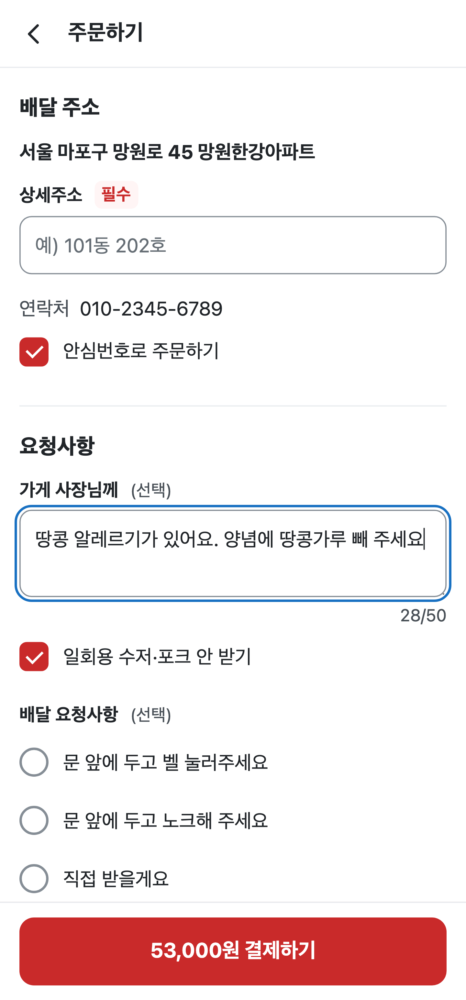
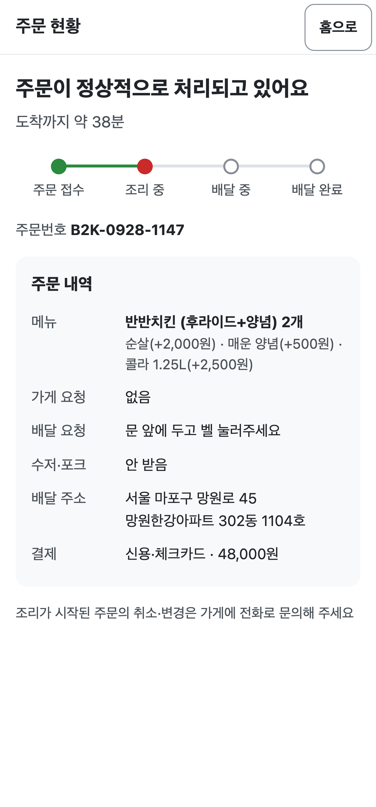
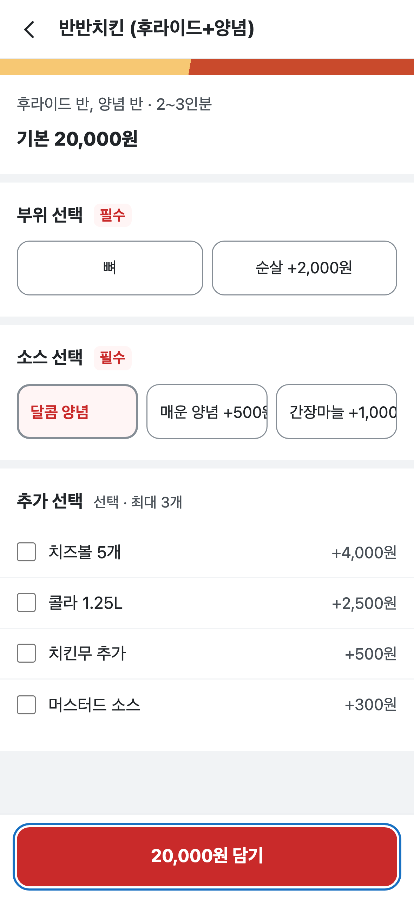

# 동네한끼 주문 QA 보고서

작성일: 2026-10-01 · 대상은 로컬 benchmark fixture A/B입니다. 실제 참여자·주문·결제는 없습니다. 화면의 주소와 연락처도 시험용 값입니다.

## 결론

**판단 불가 (`inconclusive`).** 검사 대상 A/B fixture의 현재 빌드 ID와 캡처 시점을 확인할 수 없고 현재 화면을 재실행하지 못했으므로, 빌드 접근과 최소 점검 근거가 부족한 경우의 규칙을 적용합니다.

1. 요청을 주문 초안에 보존합니다(F-01). 뒤로 이동·쿠폰·주소 오류 뒤에도 같은 요청이 최종 요약에 남는지 재실행합니다.
2. 필수 부위를 키보드로 고르게 합니다(F-02). “순살 +2,000원” 선택과 담기 뒤 장바구니의 선택값을 확인합니다.
3. 수량 버튼에 메뉴와 동작 이름을 제공합니다(F-03). 접근성 트리에서 두 버튼의 이름을 구분하고 수량 2를 확인합니다.

**시험하지 않은 것:** 현재 빌드, 수정 후 재실행, 전체 키보드 결제, 실제 기기·보조기술, 운영 결제·인증·가게 수신.

## 발견

현재 빌드에서 검증 완료한 발견은 없습니다. 실행 중 영수증이 없는 P0/P1 후보 세 건은 부록의 카드로 남깁니다. 원본의 A 권고를 현재 출시 승인으로 사용할 근거도 부족합니다.

## 수정 전후

수용된 수정은 없으며 수정 후 재실행도 하지 않았습니다. 요청 입력 화면과 주문 요약은 같은 B 실행에서 상태가 바뀐 자료입니다. A와 B는 별도 후보 페이지입니다. 수정 전후 비교를 완료하려면 원래 실패의 영수증·빌드, 실제 변경, 같은 시나리오·기기의 새 재실행 영수증이 필요합니다.

## 시나리오와 점검 범위

분모는 제공된 번들의 시나리오 일곱 개와 두 모바일 화면 설정입니다. 아래는 원본 실행의 범위입니다. 현재 빌드에서 다시 실행한 시나리오는 0/7입니다. 시나리오 실행과 온전한 과업 완료를 따로 셉니다.

| 시나리오 | 조건·근거 | 과업 | 빌드 | 기기·화면·입력 | 정상·복구 경로 | 원본 실행/계획 | 원본 과업 결과 |
| --- | --- | --- | --- | --- | --- | --- | --- |
| S-A-galaxy-s24-ultra | P-first/P-interrupted; 브리프 기반 합성 조건 | 요청·옵션을 유지한 48,000원 시험 주문 | A; ID 미제공 | S24 Ultra 설정; 384×824; 터치 | 정상, 쿠폰 오타·주소 누락·뒤로 복귀 | 1/1 | 원본 기록상 완료 |
| S-B-galaxy-s24-ultra | 같은 합성 조건 | 같은 내용의 시험 주문 | B; ID 미제공 | S24 Ultra 설정; 384×824; 터치 | 정상, 쿠폰 오타·뒤로 복귀 | 1/1 | 결제 완료; 요청 보존 실패로 기록 |
| S-A-iphone-15 | P-first; 브리프 기반 합성 조건 | 같은 내용의 시험 주문 | A; ID 미제공 | iPhone 15 설정; 393×852; 터치 | 정상; 복구 세부 기록 부족 | 1/1 | 원본 기록상 완료 |
| S-B-iphone-15 | P-interrupted; 브리프 기반 합성 조건 | 같은 내용의 시험 주문 | B; ID 미제공 | iPhone 15 설정; 393×852; 터치 | 정상, 요청 재입력·주소 오류 | 1/1 | 요청 재입력 대처 뒤 완료로 기록 |
| S-A-keyboard | P-keyboard; 합성 입력 조건 | 필수 부위·소스 선택 | A; ID 미제공 | 393×852; 키보드 | 필수 옵션; 전체 결제 제외 | 1/1 | 옵션 선택 완료로 기록 |
| S-B-keyboard | P-keyboard; 합성 입력 조건 | 필수 부위·소스 선택 | B; ID 미제공 | 393×852; 키보드 | 필수 옵션; 전체 결제 제외 | 1/1 | 필수 부위 선택 실패로 기록 |
| S-B-reflow-320 | P-zoom; 합성 화면 조건 | 좁은 폭에서 금액 읽기 | B; ID 미제공 | 320×852; scripted 터치 | 금액 확인; 결제 제외 | 1/1 | 화면을 관찰함; 완료 판정 근거 부족 |

출처: [원본 실행·관찰 요약](qa-provenance.json). 위 기록의 `driver_success=true`는 선언한 텍스트의 일치 결과입니다. 과업 판정에는 옵션·수량·금액·요청 보존을 함께 확인해야 합니다. 원본 기록의 실행 네 회를 참여자 네 명으로 세지 않습니다.

| 점검 차원 | 현재 빌드 실행/계획 | 원본 자료의 범위·완료 | 남은 공백 |
| --- | --- | --- | --- |
| 시나리오 | 0/7 | 7/7 실행; 과업별 결과는 위 표 | 현재 빌드 ID와 재실행 |
| 기기 설정 | 0/2 | 2/2 화면 설정; 실제 기기 시험 없음 | 두 기기·실제 브라우저 |
| 정상 주문 | 0/4 | A/B×두 폭 4/4 결제; 요청을 재입력하지 않고 보존한 기록은 A의 2/4 | 결제 성공과 주문 내용 무결성을 함께 검사 |
| 복구 경로 | 0/4 조합 | 복구 기록이 있는 터치 조합 3/4; A-i15의 복구 세부 기록 부족 | 네 조합 각각 하나 이상의 복구 경로 |
| 우선 접근성 과업 | 0/2 | 필수 선택과 수량 이름에 대한 원본 관찰; 새 검증 없음 | 연속 키보드 입력·접근성 트리 |
| 보충 화면 폭 | 0/3 | 384·393·320 CSS px, 3/3 관찰 | 실제 확대·키보드가 뜬 화면 |

접근성 공식 원문과 현재 화면의 대조는 KWCAG 2.2·WCAG 2.2 모두 미검사입니다. 항목 번호·제목은 원본이 참고한 스킬 노트 수준이므로 카드에서 미확인으로 둡니다. 보조기술 독립 주문은 시험하지 않았습니다.

## 조사 방법

- 원본 자료 기간: 2026-09-30T17:24:38Z ~ 2026-09-30T18:04:05Z. 전체 준비 시작은 원본 critique에 2026-09-30T17:21:14.444Z로 기록돼 있습니다.
- 원본 도구: Chromium 141.0.7390.37, Playwright 1.56.1, bundled web driver와 제공된 외부 브라우저 연결. S24 설정은 DPR 3.75, iPhone 설정은 DPR 3입니다. 실제 Galaxy·Safari 엔진을 확인한 자료는 없습니다.
- 이번 검토: 제공된 이미지·번들·보고서로 자료를 정리하고 캡처 두 묶음에 self-pass를 했습니다. 브라우저 조작·제품 수정은 하지 않았습니다. 차단 이유는 현재 페이지 파일·빌드 ID·실행 중 캡처 영수증이 제공되지 않은 것입니다.
- 원본은 로컬 시험 주문의 입력만 허용했습니다. 운영 PG, 인증번호, CAPTCHA, 실제 가게 수신은 범위 밖입니다.
- 커뮤니티 조사는 요청되지 않았고 수행하지 않았습니다. 외부 페이지 접근·연구 주장·gate 상태는 해당 없음입니다.
- 세 이미지의 바이트를 그대로 복사했습니다. 새 sha256은 복사 동일성을 나타냅니다. 원래 `captured_at`, `build_id`와 텍스트 덤프가 없어 해당 영수증 필드는 null입니다. 화면에서 옮긴 관련 텍스트는 수동 발췌로 표시했습니다.
- [2차 확인 기록](qa-second-pass.json)은 아래 카드 초안을 작성하기 전에 남긴 self-pass입니다. 원본 보고서는 앞서 읽었으므로 기억의 영향을 배제할 수 없습니다. 독립된 검토자로 표현하지 않습니다. 이미지가 입증하지 못하는 동작은 미검증으로 남겼습니다.

## 부록: 미검증 발견과 다음 근거

아래 심각도는 원본 관찰이 같은 조건에서 다시 재현될 때의 사용자 영향에 따른 우선순위입니다. 현재 빌드 검증 상태는 세 건 모두 미검증입니다. 모든 P0/P1 영수증의 캡처 시각·빌드 ID가 비어 있어 실행 시작보다 새롭다는 조건을 확인할 수 없습니다.

### F-01 · P0 · 안전 요청이 빠진 주문을 확정할 위험

- **위치:** B, 현재 빌드 ID 미제공. 주문 입력→주문 현황. S24 Ultra 설정 384×824 CSS px/DPR 3.75, 터치. 원본은 393×852에서도 같은 이동의 유실을 기록했습니다.
- **대상·과업:** P-interrupted, S-B-galaxy-s24-ultra. 브리프 기반 합성 조건으로, 요청을 적은 뒤 메뉴·수량을 재확인하고 같은 내용으로 주문하는 과업입니다.
- **재현 단계:**
  1. 새 격리 세션에서 `http://127.0.0.1:8765/dev-2/site/delivery/delivery-b.html`을 엽니다.
  2. 반반치킨·순살·매운 양념·콜라 1.25L를 담고 수량을 2로 바꿉니다.
  3. 주문 화면의 “가게 사장님께”에 “땅콩 알레르기가 있어요. 양념에 땅콩가루 빼 주세요”를 적습니다.
  4. 상단 뒤로 가기로 장바구니에 갔다가 “주문하기”를 누릅니다.
  5. 시험 상세주소와 쿠폰 `HANKKI5000`을 입력하고 시험 카드로 확정한 뒤 “가게 요청”을 확인합니다.
- **기대:** 화면을 오가도 같은 요청이 남고 최종 “가게 요청”에 입력 문장이 표시돼야 합니다.
- **관찰:** 원본 OBS-01은 복귀 뒤 “28/50”이 “0/50”으로 바뀌었다고 기록합니다. 제공된 앞 이미지에는 입력 문장과 “28/50”, 최종 이미지에는 “가게 요청”과 “없음”, “48,000원”이 보입니다. 중간 촉발 동작은 정지 이미지로 분리해 확인할 수 없습니다.
- **근거:** [입력 화면](assets/qa-request-before.png) · [입력 텍스트](assets/qa-request-before.txt) · [입력 영수증](assets/qa-request-before.receipt.json); [최종 화면](assets/qa-request-after.png) · [최종 텍스트](assets/qa-request-after.txt) · [최종 영수증](assets/qa-request-after.receipt.json). 원본 관찰 ID OBS-01, 실행 R-B-S24.
- **영향:** 추론: 주문을 확정한 사람이 안전 요청의 누락을 알아채지 못할 수 있습니다. 실제 조리 전달·위해 발생은 미확인입니다. 이 조건이 재현되면 안전 정보 손실의 P0 정의에 해당합니다.
- **원인:** 원본의 관찰은 화면 복귀와 요청 유실입니다. H-01은 입력 값이 화면 재구성 뒤 주문 초안에서 복원되지 않는다는 가설입니다. 서버 저장과 조직의 책임은 모릅니다.
- **수정:** 상호작용·데이터 보존 층위. 요청을 하나의 주문 초안에 저장하고 뒤로 이동·쿠폰·주소 오류 후 복원합니다. 완료·취소 때 초안을 정리해야 합니다. 성공 상태는 두 폭에서 같은 요청이 최종 요약과 시험 수신 데이터에 남는 것입니다.
- **표준:** 이 카드는 주문 내용 보존의 기능 결함 후보입니다. 접근성 기준 판정은 미검사입니다.
- **2차 확인:** `{finding_id: F-01, reviewer: self, task_completed: false, control_name: 가게 요청, omitted: 중간 이벤트·캡처 시각·빌드, severity: agree, inconclusive: true}`. 영향 우선순위는 유지합니다. 새 빌드에서 이동별 값을 확인하고 영수증을 남길 때까지 미검증으로 둡니다.
- **확신도:** 현재 판정 low. 앞뒤 이미지의 값 차이는 읽을 수 있지만 현재 빌드·촬영 시각·이동 기록은 확인할 수 없습니다. 원본의 high 평가는 그대로 출처 기록에 남겼습니다.

### F-02 · P1 · 필수 선택 실패가 키보드 주문을 막을 위험

- **위치:** B, 현재 빌드 ID 미제공. 반반치킨 옵션. iPhone 15 설정 393×852 CSS px/DPR 3, 키보드.
- **대상·과업:** P-keyboard, S-B-keyboard. 브리프 기반 합성 조건이며, 키보드만으로 필수 부위와 소스를 고르고 담는 과업입니다.
- **재현 단계:**
  1. 새 세션에서 같은 B 시작 URL을 엽니다.
  2. Tab 13회로 반반치킨에 초점을 두고 Enter를 누릅니다. 초점 순서가 바뀌었으면 단계별 제어 이름을 기록합니다.
  3. 옵션 제목에서 Tab을 눌러 “부위 선택”에 도달하는지 확인합니다.
  4. Space로 “달콤 양념”을 고르고 Tab 5회로 “담기”에 도달한 뒤 Enter를 누릅니다.
- **기대:** “뼈”, “순살 +2,000원”이 키보드 순서에 들어오고 선택 후 장바구니로 이동해야 합니다.
- **관찰:** 원본 OBS-02는 Tab이 부위를 건너뛰고 담기 후 같은 화면에 머문 것으로 기록합니다. 제공된 이미지에는 미선택 부위와 선택된 “달콤 양념”, 초점 테두리가 있는 “20,000원 담기”가 보입니다. 정지 이미지에서 앞선 Tab·Enter 실패를 확정할 수 없습니다.
- **근거:** [옵션 화면](assets/qa-keyboard.png) · [텍스트](assets/qa-keyboard.txt) · [영수증](assets/qa-keyboard.receipt.json). 원본 OBS-02/R-B-keyboard는 generic 요소와 초점 불가 측정을 기록하지만, 원래 접근성 덤프 파일은 이번 자료에 없습니다.
- **영향:** 추론: 필수 선택이 초점을 받지 않으면 키보드만 쓰는 사람은 담기를 끝낼 수 없습니다. 터치로 대신 선택하는 방법은 키보드 독립 주문의 대처가 되지 않습니다.
- **원인:** H-02는 포인터 동작만 연결한 필수 선택 요소라는 가설입니다. 원본이 기록한 초점 부재와 옵션 화면 잔류를 연결한 설명이며, 현재 컴포넌트 코드는 검사하지 않았습니다.
- **수정:** 접근성·상호작용 층위. `fieldset`·`legend`, native radio와 label을 연결합니다. 기존 카드 스타일과 선택·초점을 다시 맞춰야 합니다. 성공 상태는 Tab·방향키·Space·Enter로 순살을 고르고 장바구니에 선택값을 담는 것입니다. 이후 전체 키보드 결제도 시험합니다.
- **표준:**

| KWCAG 2.2 항목 | KWCAG 상태·근거 | WCAG 2.2 기준 | WCAG 상태·근거 |
| --- | --- | --- | --- |
| 6.1.1 키보드 사용 보장 | 미확인: 원본 참고 번호; 공식 원문·현재 동작 미대조 | 2.1.1 Keyboard | 미확인: 원본 참고 번호; 공식 원문·현재 동작 미대조 |
| 8.2.1 웹 애플리케이션 접근성 준수 | 미확인: 현재 역할·선택 상태 미검사 | 4.1.2 Name, Role, Value | 미확인: 현재 이름·역할·상태 미검사 |

- **2차 확인:** `{finding_id: F-02, reviewer: self, task_completed: null, control_name: 20,000원 담기, omitted: 연속 입력·초점 측정, severity: disagree, inconclusive: true}`. 해결 기록: 이미지가 실패를 입증하지 못하므로 P1은 재시험 우선순위로 유지합니다. 입력 이벤트와 새 영수증이 생길 때까지 미검증으로 둡니다.
- **확신도:** 현재 low. 화면 상태는 읽을 수 있으나 실패의 연속 입력 기록과 현재 빌드가 없습니다.

### F-03 · P1 · 수량 동작을 구분할 이름이 없을 위험

- **위치:** B, 현재 빌드 ID 미제공. 장바구니. S24 Ultra 설정 384×824 CSS px/DPR 3.75, 터치 및 별도 접근성 관찰.
- **대상·과업:** P-keyboard, S-B-galaxy-s24-ultra. 합성 입력 조건이며, 반반치킨의 수량을 2로 바꾸고 확인하는 과업입니다.
- **재현 단계:**
  1. 같은 B 시작 URL의 새 세션에서 순살·매운 양념·콜라를 담습니다.
  2. 장바구니에서 “+”로 수량을 1에서 2로 바꿉니다.
  3. 활성화된 증가·감소 버튼의 접근 가능한 이름을 트리에서 읽고 실제 보조기술로 조작합니다.
- **기대:** 메뉴와 동작을 구분하는 이름이 있어야 합니다. 제안 이름은 “반반치킨 수량 늘리기”, “반반치킨 수량 줄이기”입니다.
- **관찰:** 원본 OBS-03은 두 버튼을 `role=button, name="", name_source=none`으로 기록합니다. [원본 수량 이미지](../../_evidence/dogfood-persona/runs/R-B-S24/S-R-B-S24-010.png)에는 “−”, “2”, “+”, “50,000원 주문하기”가 보입니다. 접근 가능한 이름의 부재는 이미지에서 확인할 수 없습니다.
- **근거:** [원본 관찰 요약](qa-provenance.json) · [수동 화면 텍스트](assets/qa-quantity.txt) · [미검증 영수증](assets/qa-quantity.receipt.json). 이 이미지는 원본 경로를 참조합니다. 원래 접근성 덤프·현재 촬영 시각은 없습니다.
- **영향:** 추론: 메뉴와 증가·감소 동작을 구분하지 못하면 이 과업의 필수 수량을 고르기 어렵습니다. 실제 TalkBack·VoiceOver 발화와 오입력은 관찰하지 않았습니다.
- **원인:** H-03은 아이콘 표시와 의미 이름을 함께 관리하지 못했다는 가설입니다. 원본이 기록한 이름의 빈 값은 구현·조직 원인을 확정하지 못합니다.
- **수정:** 접근성·문구 층위. 버튼마다 메뉴명과 증가·감소 동작을 연결하고 수량 변경을 알립니다. 항목이 여러 개일 때 이름 중복과 긴 발화를 점검해야 합니다. 성공 상태는 이름으로 원하는 버튼을 고르고 두 항목의 수량을 각각 바꾸는 것입니다.
- **표준:**

| KWCAG 2.2 항목 | KWCAG 상태·근거 | WCAG 2.2 기준 | WCAG 상태·근거 |
| --- | --- | --- | --- |
| 8.2.1 웹 애플리케이션 접근성 준수 | 미확인: 원본 참고 번호; 현재 의미 정보·원문 미대조 | 4.1.2 Name, Role, Value | 미확인: 원본 참고 번호; 현재 의미 정보·원문 미대조 |

- **2차 확인:** `{finding_id: F-03, reviewer: self, task_completed: null, control_name: +, omitted: 접근 가능한 이름·보조기술 입력, severity: disagree, inconclusive: true}`. 해결 기록: 원본 P1은 재시험 우선순위로 유지합니다. 접근성 트리와 실제 입력을 확인할 때까지 미검증으로 둡니다.
- **확신도:** 현재 low. 원본의 측정 진술은 있지만 원래 덤프와 현재 화면 검증이 없습니다.

### 캡처 자료

세 장은 제공된 로컬 fixture 이미지의 동일한 복사본입니다. 모두 현재 출시 판정에는 미검증 자료입니다.

### 남은 가설·자료 공백

| ID | 내용 | 상태·한계 | 다음 근거·시험 |
| --- | --- | --- | --- |
| H-01 | 요청이 주문 초안에서 복원되지 않음 | 추론; 구현 미검사 | 뒤로·쿠폰·주소 오류를 각각 분리하고 입력 직후 값을 비교 |
| H-02 | 필수 선택에 포인터 동작만 연결됨 | 추론; 원래 트리·현재 코드 없음 | Tab 이벤트, 역할·선택 상태와 실제 담기 결과 |
| H-03 | 아이콘과 의미 이름의 관리가 분리됨 | 추론; 구현·조직 미확인 | 이름 계산 경로와 실제 보조기술 입력 |
| F-04 | 소스 추가 금액 끝이 잘렸다는 원본 관찰 | 현재 미검증; 추가 후보 | 320·384·393 px, 선택 전후 가격·단위 표시 |
| F-05 | 추가 옵션 글자가 반응하지 않았다는 원본 관찰 | 현재 미검증; 추가 후보 | 글자·빈 공간·체크박스의 한 번 토글, 간격 예외 |
| F-06 | 쿠폰 오타에 내부 코드만 보였다는 원본 관찰 | 현재 미검증; 추가 후보 | 오타·만료·최소금액 사유별 복구 |
| F-07 | 현재 조리 단계의 색 외 단서가 부족하다는 원본 판단 | 현재 미검증; 명도·형태 단서 평가 부족 | 단계별 문구·도형·명도 예외·실제 판독 |
| F-08 | 320 px에서 금액 영역이 360 px였다는 원본 관찰 | 현재 미검증; 실제 확대 미검사 | 좁은 폭·실제 확대에서 모든 금액·단위 표시 |
| G-01 | 현재 빌드·캡처 영수증·원래 텍스트 덤프 없음 | 접근·근거 공백 | 새 빌드 ID와 실행 시작, 캡처별 영수증·텍스트·입력 trace |
| G-02 | 전체 키보드 결제·가게 수신·수정 후 결과 없음 | 미검사 | 허용된 시험 환경에서 같은 주문 내용의 전체 경로 재실행 |

## 완료 점검

- 결론이 첫 절입니다. 판정 규칙과 빌드 공백, 세 행동, 시험하지 않은 것 한 줄을 적었습니다.
- P0/P1 세 후보의 영수증 필드와 self-pass 기록을 연결했습니다. 캡처 시각·빌드가 없어 세 건 모두 부록의 미검증 상태입니다. 두 불일치의 해결을 적었습니다.
- 연구 주장은 해당 없음입니다. 지원되지 않은 사실 주장과 원인 가설은 부록에 두었습니다. 수정 전후 검증은 미실행으로 적었습니다.
- KWCAG 2.2와 WCAG 2.2의 상태를 따로 적었습니다. 분모와 현재 0/n 범위, 도구·보조기술의 한계를 밝혔습니다.
- 실제 사람의 이름·닉네임·발화는 없습니다. fixture 표시, 인용·날짜·문체와 자료 링크를 자체 점검했습니다. 현재 출시 승인과 수정 완료는 남아 있습니다.
